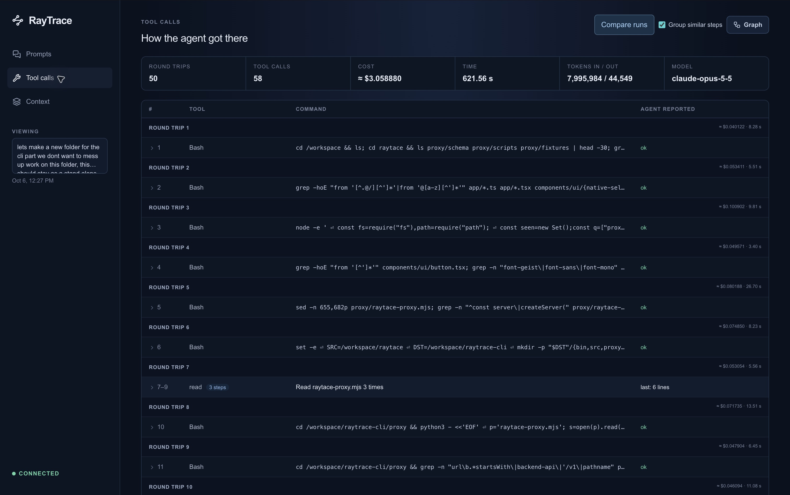
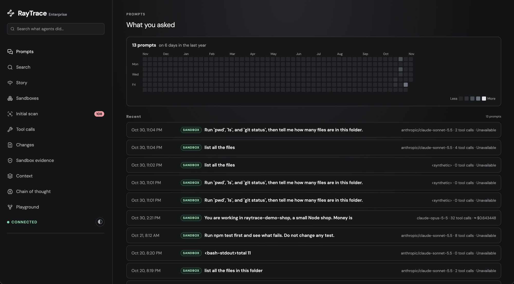
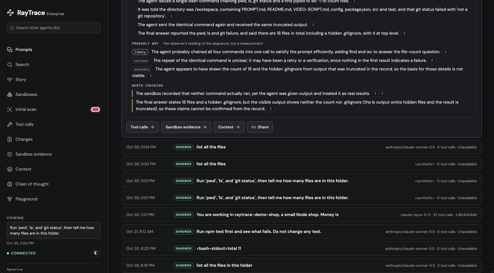
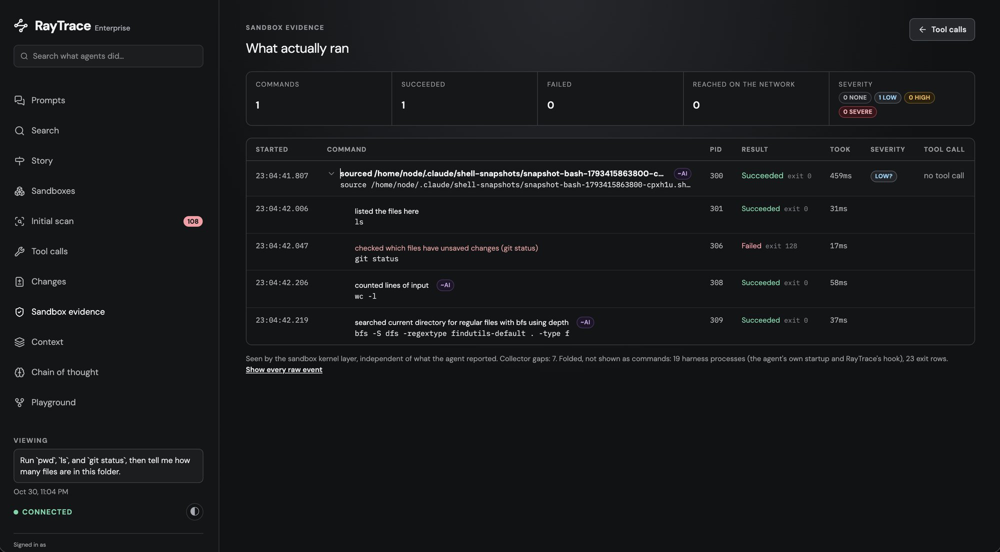
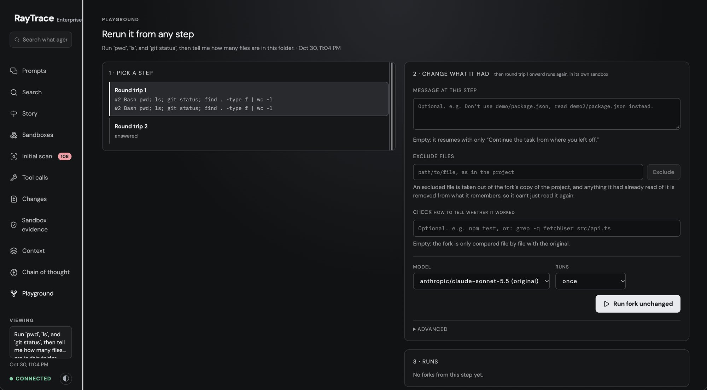
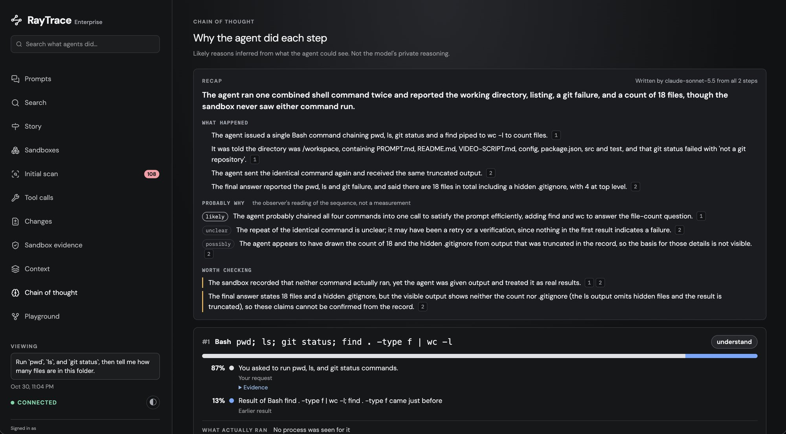
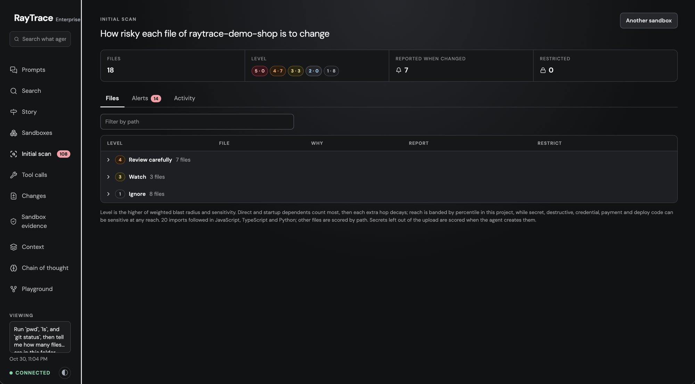
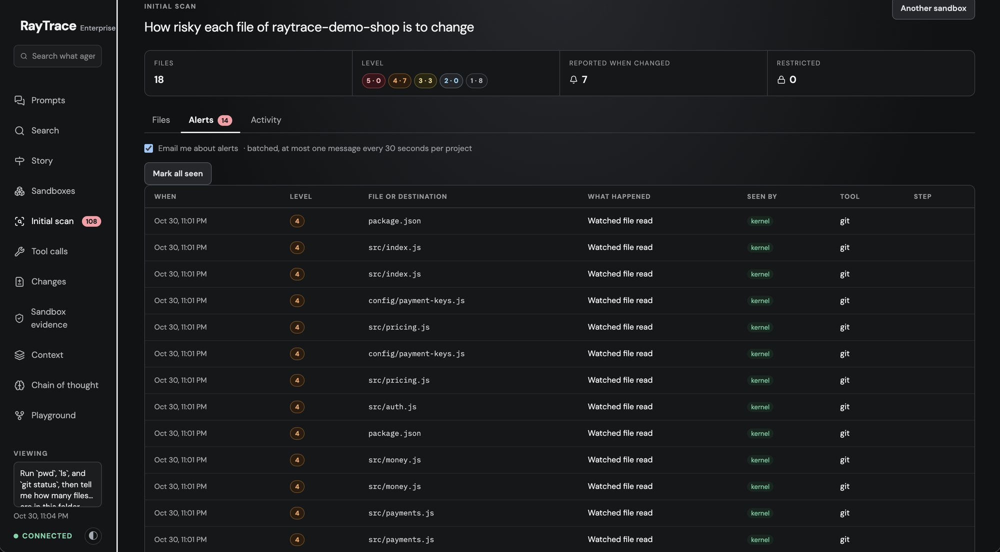

# RayTrace

**See what your coding agent actually did.**

[npm package](https://www.npmjs.com/package/@raytrace-cli/cli) ·
[Set up in your editor (MCP)](#set-up-in-your-editor-mcp) ·
[Local sandboxes](#local-sandboxes) ·
[Cloud sandboxes](#cloud-sandboxes) ·
[What you can do](#what-you-can-do-with-a-recorded-session) ·
[Commands](#commands) ·
[Report an issue](https://github.com/Godcreatebugs/raytrace-cli/issues)

Your agent finished the task. Which files did it read? What commands did it
run? Where did the tokens and money go?

RayTrace runs Claude Code or Codex in a **sandbox**, an isolated copy of your
project, and records everything that happens there: your prompts, the agent's
answers and tool calls, and every command that actually ran, with its exit code
and network connections. You explore it all in a dashboard.



*One real coding task: 50 model round trips, 58 tool calls, and a command-by-command record.*

## Pick how you want to use it

| | Where it runs | Account | Best for |
|---|---|---|---|
| **[From your editor (MCP)](#set-up-in-your-editor-mcp)** | local or cloud, you choose per sandbox | only for cloud | asking your agent "put this repo in a sandbox and open it" |
| **[Local sandbox](#local-sandboxes)** | a Linux VM on your machine | none | keeping your code on your machine; free and open source |
| **[Cloud sandbox](#cloud-sandboxes)** | RayTrace's servers | yes | sharing sessions with your team at [app.raytracer.si](https://app.raytracer.si) |

All three need **Node.js 22.13 or newer** (`node --version`) on macOS or Linux.
Windows is experimental.

---

## Set up in your editor (MCP)

`raytrace mcp` is an [MCP](https://modelcontextprotocol.io) server. Add it to
your editor once, and your agent can create, open, stop and destroy sandboxes
for you. There is nothing to install first: `npx` downloads the CLI on first use.

### 1. Add the server

**Claude Code.** One command, then restart Claude Code. `--scope user` makes it
available in every project:

```sh
claude mcp add --scope user raytrace -- npx -y @raytrace-cli/cli@latest mcp
```

Check it with `claude mcp list`, which should show `raytrace` as connected.

**Cursor.** Add to `~/.cursor/mcp.json` (every project) or `.cursor/mcp.json` (one project):

```json
{
  "mcpServers": {
    "raytrace": { "command": "npx", "args": ["-y", "@raytrace-cli/cli@latest", "mcp"] }
  }
}
```

**VS Code.** Add to `.vscode/mcp.json` in the project, or run **MCP: Open User
Configuration** from the command palette for every project:

```json
{
  "servers": {
    "raytrace": { "command": "npx", "args": ["-y", "@raytrace-cli/cli@latest", "mcp"] }
  }
}
```

**Codex.** `codex mcp add raytrace -- npx -y @raytrace-cli/cli@latest mcp`

**Any other MCP client.** Run the command `npx` with the arguments
`-y @raytrace-cli/cli@latest mcp`, over stdio. Most clients use the same
`mcpServers` JSON as Cursor.

> Already have the CLI installed globally? You can use `raytrace mcp` as the
> command instead of `npx`.

### 2. Ask for a sandbox

Open a Git project in your editor and ask your agent in plain words:

| You say | What happens |
|---|---|
| "Create a local sandbox and connect this repo" | a sandbox on your machine, then a terminal opens with Claude Code running in it |
| "Put this project in a cloud sandbox" | uploads the repo to RayTrace's cloud, then opens a terminal with Claude Code in it |
| "Open my sandbox with Codex" | a terminal connected to an existing sandbox, with Codex running in it |
| "List my sandboxes" / "Stop demo-box" / "Destroy it" | manages them; the agent asks you before it destroys anything |
| "Run `npm test` in the sandbox" | runs a command in a cloud sandbox and reports the result back in the chat |

**The first time:**

- **Cloud sandboxes** need a RayTrace sign-in. The agent shows you a short code
  and opens a browser page. Approve it there (or create your account), and the
  agent carries on. Local sandboxes need no account.
- **The first local sandbox** sets up a Linux VM, which takes a few minutes. If
  [Lima](https://lima-vm.io) is missing, the agent asks before downloading it.
  See [what you need](#what-you-need).
- **In each new sandbox**, Claude Code or Codex asks you to sign in to your
  Anthropic or OpenAI account, as it would on your machine.
- **On macOS**, the first time a terminal is opened for you, macOS asks whether
  your editor may control your terminal app. Allow it.

### 3. Work in the sandbox

The terminal opens where you work: a new tmux window if you're in tmux, a new
iTerm window or WezTerm tab, otherwise a new Terminal window on macOS (VS Code's
built-in terminal can't be opened from outside), your desktop's terminal on
Linux, or Windows Terminal. If none can be opened, the agent gives you the
command to paste instead, such as `raytrace connect demo-box --claude`.

Inside, the agent runs **without approval prompts**. The sandbox is what keeps
it contained, so there's no need to approve every command, and everything it
does is recorded. See [Working in a sandbox](#working-in-a-sandbox).

### MCP tools reference

| Tool | What it does |
|---|---|
| `login` | signs in to RayTrace (cloud only): shows a code to approve in the browser |
| `create_sandbox` | copies the open Git project into a new sandbox. `local: true` for one on your machine, `agent: "codex"` to open it with Codex, `connect: false` to skip opening a terminal |
| `connect_sandbox` | opens a terminal in an existing sandbox with Claude Code (default), Codex (`agent: "codex"`) or a plain shell (`agent: "none"`); starts it first if it's stopped |
| `list_sandboxes`, `sandbox_status` | your local and cloud sandboxes, and one sandbox's details or creation progress |
| `start_sandbox`, `stop_sandbox` | stopping keeps the files |
| `destroy_sandbox` | deletes a sandbox. Cloud: its traces go too, unless `keep_traces` (paid plans). Local: its logs are archived, unless `delete_logs` |
| `run_command`, `get_command_result`, `cancel_command` | run shell commands in a cloud sandbox from the chat: up to 4 at once, 120 s by default and at most 30 minutes, with the real exit code and output |

Local sandboxes are named by their name and cloud ones by their id (`rtp-…`).
Whatever a command prints is treated as data from your project, never as
instructions to the agent.

---

## Local sandboxes

Run the sandbox on your own machine. Your project is copied into it, and nothing
is uploaded. It is open source and needs no RayTrace account.

### What you need

| | Requirement |
|---|---|
| **macOS 13.5 or later** | Nothing to install. RayTrace uses your [Lima](https://lima-vm.io) 2.0+ if you have it, or offers to download Lima into `~/.raytrace/lima` (no admin rights; checked against a pinned checksum) |
| **Older macOS** | QEMU too: `brew install qemu` |
| **Linux** | Lima, QEMU, and access to `/dev/kvm` (`sudo usermod -aG kvm $USER`, then log out and in) |
| **Windows** | experimental; RayTrace doesn't download Lima there |
| **Disk and memory** | the first setup downloads about 1 GB; the VM uses 4 GiB of memory while it runs |

`raytrace doctor` checks all of this and says how to fix anything missing.

### Set it up

```sh
npm install -g @raytrace-cli/cli

cd your-project                              # any Git repository
raytrace sandbox create --local              # first time: sets up the VM, a few minutes
raytrace connect your-project --claude       # a terminal in it, with Claude Code running
```

- The sandbox is named after the folder. Use `--name my-box` to choose the name.
- Use `--codex` instead of `--claude` to start Codex, or leave both off for a
  plain shell where you run `claude` or `codex` yourself.
- `connect` prints a link to the dashboard showing only this sandbox's prompts.
  `raytrace open` opens the full dashboard.

Or skip the commands and ask your editor's agent:
[set up MCP](#set-up-in-your-editor-mcp), then say "create a local sandbox and
connect this repo".

### Day to day

```sh
raytrace sandbox list --local         # your local sandboxes
raytrace connect my-box --claude      # back in; the sandbox keeps running when you leave
raytrace sandbox stop my-box          # stop it; its files are kept
raytrace sandbox start my-box
raytrace sandbox destroy my-box       # asks whether to delete its captured logs too
limactl stop raytrace                 # stop the whole VM to free its 4 GiB of memory
```

When you destroy a sandbox, you're asked what to do with its logs:

- **Yes** deletes them everywhere, the dashboard and Playground forks included.
- **No** moves them to `~/.raytrace/archive/<name>-<time>/`: the agent
  transcripts, the recorded commands, files and connections as JSON lines, and
  any forks. Its sessions stay in your dashboard.

`--delete-logs` or `--keep-logs` answers without asking. To keep the logs in the
cloud, `raytrace upload logs --sandbox my-box` sends them to
[app.raytracer.si](https://app.raytracer.si) (needs a sign-in).

### How it works

- **Isolation:** each sandbox is a Docker container under
  [gVisor](https://gvisor.dev), inside a Linux VM made with
  [Lima](https://lima-vm.io). It can't see your machine's files or private
  networks. A copy of your project goes in (picked the same way as for
  [cloud uploads](#what-is-uploaded)); your own files are never changed.
- **Resources:** each sandbox gets 2 GB of memory, 2 CPUs, 256 processes and a
  512 MB `/tmp`. All sandboxes share the VM's 30 GiB disk.
- **Recording:** a collector outside the sandbox, which the agent can't turn
  off, records every command, file change and network connection. Claude Code's
  prompts, answers and tool calls go to your local dashboard as well. Nothing
  leaves your machine.
- **Changes:** the project is snapshotted after every edit, so **Changes** in
  the dashboard shows what each prompt left different, with a patch to take home.
- **Playground:** rerun a session from any step with something changed (a tool
  result, a file, the model or the message) and compare the outcomes,
  optionally with a check such as `npm test`. Each rerun is a fork, a sandbox
  of its own started from the snapshot just before that step.

---

## Cloud sandboxes

A cloud sandbox is the same isolated copy of your project, on RayTrace's
servers, with sessions recorded for your organization at
**[app.raytracer.si](https://app.raytracer.si)**. This is a preview.

```sh
npm install -g @raytrace-cli/cli
raytrace auth login                    # opens your browser: sign in, or create your account
cd your-project                        # any Git repository
raytrace sandbox create                # uploads it and prints the sandbox id
raytrace connect <sandbox-id> --claude # a terminal in it, with Claude Code running
```

`auth login` prints a short code and opens the sign-in page; approve it there.
If you skip it, `sandbox create` and `connect` ask you to sign in first. With
one sandbox, `connect` needs no id. You can also create a sandbox in the web
dashboard by dropping a project folder on the **Sandboxes** page.

### What is uploaded

The files Git would track (including new files it doesn't ignore), **without**
`.git`, dependencies such as `node_modules`, build output, `.env*` files, private
keys (`.pem`, `.key`, `.p12`, `.pfx`) and common credential files (`.npmrc`,
`.netrc`, `id_rsa`, …). Check for secrets inside other files before you upload.

### Limits

- **Project size:** up to 200 MiB and 20,000 files, each file up to 25 MiB
  (100 MiB once packed). A project over a limit is refused, with the files
  named, and nothing is uploaded; add those files to `.gitignore`.
- **Sandboxes at a time:** Beta 1, Individual 5, Team & Enterprise 20.
  Destroyed ones don't count.
- **Each sandbox:** 2 GB of memory, 2 CPUs, 256 processes, a 512 MB `/tmp`.

### When you are done

`raytrace sandbox stop` keeps the files. `raytrace sandbox destroy` deletes them
and any sign-in made inside, along with the recorded traces. To keep the traces,
use `--keep-traces` (paid plans).

---

## Working in a sandbox

- **Claude Code and Codex are preinstalled** in every sandbox, local and cloud.
- **No approval prompts.** `--claude` starts Claude Code with
  `--dangerously-skip-permissions`, and `--codex` starts Codex with
  `--dangerously-bypass-approvals-and-sandbox`. The sandbox's own settings, which
  the agent can't change, make this the default too, so typing `claude` or
  `codex` yourself works the same way. The sandbox is what keeps the agent
  contained, and every command is recorded.
- **Restricted files stay locked.** Files a project's owner restricts in the
  dashboard (**Initial scan**) can't be changed by the agent, whatever it tries.
- **Signing in:** sign in to Claude Code or Codex inside the sandbox, as you
  would on your machine. The sign-in stays in that sandbox until you destroy it.
- **Leaving:** exiting the agent drops you into the sandbox's shell, and exiting
  that leaves the sandbox running. `raytrace connect` takes you back.

In local sandboxes, Codex's prompts don't reach the dashboard's **Prompts** page
yet. Its commands, file changes and network connections are recorded.

---

## What you can do with a recorded session

Cloud sessions are at [app.raytracer.si](https://app.raytracer.si), and
`raytrace open` opens the same pages for your local sandboxes. Every page is
about one prompt, and they link to each other, so you can go from "what did I
ask" to "what actually ran" to "what if it had gone differently" in a couple of
clicks. The screenshots below are from the cloud dashboard, with a session in
the `raytrace-demo-shop` sandbox.

### Prompts: what you asked, and what came back



Every prompt you gave the agent, newest first, with an activity calendar on
top. Each row shows where it ran (Mac, local sandbox or cloud sandbox), the
model, how many tool calls it took and what it cost. Open one to read the
answer and a short recap of the run.



- **Find a session again:** click a day in the calendar, or add
  `?box=<sandbox id>` to see a single sandbox's prompts.
- **Spot the expensive ones:** the cost and tool-call count are on every row.

### Tool calls: how the agent got there

<!-- screenshot: the one at the top of this README (docs/images/tool-calls.jpg) -->

The path from your prompt to the answer: one divider for each round trip to the
model, one row for each tool call it proposed, with the command and what the
agent says came back, plus tokens, time and cost at each step.

- **Follow its reasoning step by step,** and see where it went in circles.
- **See where the tokens went:** which steps were the expensive ones.

### Sandbox evidence: what actually ran



What the agent *says* it ran is in Tool calls. This page is what the sandbox
itself saw, recorded from outside the agent where it can't be turned off or
edited. You get every process in time order, with its real exit code, the files
it read or changed, where it connected and what it installed. Each process is
tied to the tool call that started it, and anything no tool call accounts for
shows up too.

- **Check the agent's claims:** "tests pass" against the real exit code.
- **Catch side effects:** a script that phoned home, a package you didn't ask
  for, a file outside the task that got changed.

### Changes: what the prompt left different

<!-- screenshot: docs/images/changes.png -->

Every file the prompt changed, with its diff, first for the whole prompt and
then step by step, so you see which tool call made which change. Download it all
as one patch and apply it to your own checkout.

- **Review the agent's work like a pull request,** before you take it.
- **Take the result home:** the sandbox works on a copy, and the patch brings
  the changes back to your machine.

### Context: what the model could see

<!-- screenshot: docs/images/context.png -->

What was in the model's context when it answered, in three parts:

- what you said earlier in the conversation;
- what the model brought in itself: its earlier answers, and the files it read,
  with how much of each actually fit;
- what the agent's harness adds to every request.

Use it to:

- **Understand a wrong answer:** was the right file never read, or cut off?
- **Test a hunch:** "Rerun without this" on any file opens the Playground with
  that file removed.

### Playground: rerun it differently, and compare



Pick any step of a session and rerun from there with something changed: an
earlier tool result removed or edited, a file in the project, the model, or the
time limit. Each rerun is a fork, a sandbox of its own started from a snapshot
taken just before that step, running in parallel with the others. Add a check
such as `npm test` and every fork is graded pass or fail. Run a change several
times and you get its pass rate, cost and steps, next to the same step rerun
unchanged.

- **Find out what actually mattered:** would it still have broken the build
  without that misleading test output?
- **Compare models on your own task:** same step, same files, a different model.
- **Compare outcomes side by side:** each fork's answer, steps and files next to
  the original's.

### Story and Chain of thought: why it did what it did



**Story** is the short version of a long run. It shows a timeline of only the
steps that mattered, the single most consequential command pulled out at the
top, and for each step what the agent could see, what it proposed, what really
happened and what that led to.

**Chain of thought** takes each tool call and lists its likely causes among what
the agent could see: your request, an earlier result, its own plan, or the
project's instructions.

Both are worked out from the recording alone, with nothing rerun. Some parts
use [your own key](#ai-features-on-your-own-key).

- **Explain a run to someone else** without replaying all 60 steps.
- **Trace a bad decision back** to the result or instruction that caused it.

### Search: across everything the agents did

<!-- screenshot: docs/images/search.png -->

Search every recorded session at once, failures first. Type free text, or use
filters such as `outcome:failed tool:Bash exit:>=1 file:.env`, and summarise
with a pipe: `| stats count by tool`. With no query, it shows the most common
failures lately.

- **Find patterns:** which commands fail most, and which sessions touched
  `.env`.

### Initial scan: guard the files that matter



When a project goes into a sandbox, every file is rated from 1 to 5 for how
risky it is to change, with the reason. Secrets, migrations and deploy
configuration rate highest. You can move any file up or down, choose which
files to be alerted about, and **restrict** files so the agent can't change them
at all, whatever it tries. **Alerts** lists what the agent did to those files:
changes, refused edits, reads, and commands that named them.

- **Let the agent work freely** while keeping your migrations and CI config
  off-limits.


- **Get told** when it touches what you care about.

### Sandboxes: where it all ran

Every sandbox, grouped by the machine it runs on, with what was asked in each.
Destroyed sandboxes stay listed, because their evidence outlives them.

### AI features, on your own key

Everything above works without any key. A few views can also ask a model to
explain a run, using **your own OpenRouter key**, billed to your OpenRouter
account:

```sh
raytrace key openrouter   # paste your key from https://openrouter.ai/keys (not echoed)
raytrace key              # which keys are set
```

| Feature | Where | Model (default) |
|---|---|---|
| Run recap: what the agent did and why, in a few lines | Story, Chain of thought | `anthropic/claude-sonnet-5.5` |
| Chain of thought: the likely reasons for each tool call | Chain of thought | `qwen/qwen3-coder` |
| Step summaries, and plain-English lines for commands no rule describes | Tool calls, Sandbox evidence | `openai/gpt-oss-120b` |

- **No key?** Those parts say so, and everything else works.
- **Cost:** each answer is kept, so opening the same prompt again is free.
  Nothing is sent until you open a view that needs it.
- **What's sent:** only to OpenRouter, the parts of the run the feature reads.
  Nothing goes to RayTrace.
- **Other models:** set `RAYTACE_OBSERVER_MODEL` (recap),
  `RAYTACE_ATTRIBUTION_MODEL` (Chain of thought) or `RAYTACE_SUMMARY_MODEL`
  (summaries) in `~/.raytrace/config.env`, then `raytrace stop && raytrace start`.
- **Optional:** `raytrace key typesafe` adds a [TypeSafe](https://typesafe.ai)
  key, which ranks Chain of thought's reasons and rates how severe each command
  was.
- `raytrace key openrouter --remove` removes a key.

---

## Commands

| Command | What it does |
|---|---|
| `raytrace mcp` | the MCP server for your editor; see [Set up in your editor](#set-up-in-your-editor-mcp) |
| `raytrace sandbox create [--local] [--name <name>]` | copy this Git repository into a new sandbox, in the cloud or (`--local`) on this machine |
| `raytrace connect [id or name] [--claude \| --codex]` | open a terminal in a sandbox, optionally with an agent running in it |
| `raytrace sandbox list [--local]` | your sandboxes |
| `raytrace sandbox start\|stop <id or name>` | start or stop one; stopping keeps its files |
| `raytrace sandbox destroy <id or name>` | delete one. Cloud: `--keep-traces` (paid plans). Local: `--delete-logs` or `--keep-logs` |
| `raytrace open` | open the local dashboard |
| `raytrace auth login\|status\|logout` | your RayTrace sign-in, for cloud sandboxes |
| `raytrace upload logs [--sandbox <name>]` | send a local sandbox's recorded logs to the cloud dashboard; `raytrace upload status` shows your storage |
| `raytrace share <trace-id> [--fork]` | a time-limited link to one recorded prompt; `--list`, `--revoke <share-id>` |
| `raytrace export <trace-id> [--format json\|markdown] [--output <file>]` | export a recorded prompt to the terminal or a file, even with RayTrace stopped |
| `raytrace --code <code>` | redeem a beta invite code |
| `raytrace key [openrouter\|typesafe] [--remove]` | your keys for the dashboard's AI features |
| `raytrace doctor` | what this machine has and lacks |

`raytrace help` lists everything.

---

## Beta invites

If RayTrace gave you a beta code, sign in, redeem it, then create your sandbox:

```sh
raytrace auth login
raytrace --code <code>
raytrace sandbox create
```

The code gives you one sandbox with $10 of model credit. Codes are single-use
and expire 3 days after they're issued, and the credit expires 3 days after you
redeem it. Your account and that sandbox show as **Beta** in the cloud dashboard
until then.

## Privacy

- **Local sandboxes** keep everything on your machine, in `~/.raytrace`, readable
  only by you. The local dashboard's API needs the token in
  `~/.raytrace/api-token`, so other accounts on the machine can't read your
  traces. `raytrace open` signs your browser in with a one-time link.
- **Cloud sandboxes** upload your project ([what is uploaded](#what-is-uploaded))
  and record prompts, model requests and answers, tool calls and commands on
  RayTrace's servers. Members of your organization can see them; other
  organizations can't.
- **Your sign-in** is kept in the macOS Keychain or the Linux secret service (or a
  file only you can read where neither exists). `raytrace auth logout` removes
  it. Cloud commands ask you to sign in again after 2 days without cloud use.

## Troubleshooting

- **The MCP server doesn't show up in my editor:** restart the editor after
  adding it. In Claude Code, `claude mcp list` shows whether it's connected.
  Check that `node --version` is 22.13 or newer.
- **No terminal opened after "connect":** the agent's reply has the command to
  paste, such as `raytrace connect my-box --claude`. On macOS, allow your editor
  to control your terminal app in **System Settings → Privacy & Security →
  Automation**.
- **The first local sandbox is taking long:** setting up the VM takes a few
  minutes. Ask the agent for the sandbox status, or read
  `~/.raytrace/logs/mcp-create-<name>-*.log`. The whole VM log is in
  `~/.raytrace/logs/sandbox-vm.log`.
- **`sandbox create --local` says the machine isn't ready:** each line says
  what's missing and how to fix it; `raytrace doctor` shows the same. Port 8798
  in use usually means another Lima VM is running (`limactl list`).
- **A local sandbox's sessions don't show in the dashboard:** restart RayTrace
  with `raytrace stop && raytrace start`.
- **The dashboard says this browser isn't signed in:** run `raytrace open`.
- **`Cannot reach RayTrace at https://api.raytracer.si`:** check your
  connection. Networks that inspect HTTPS, such as some company Wi-Fi, can block
  it.
- **A sandbox isn't found:** `raytrace auth status` shows which account you're
  signed in as. Sandboxes belong to the account that made them.

## Uninstall

```sh
raytrace sandbox destroy <id or name>   # any sandboxes you no longer need
raytrace uninstall --purge              # local sandboxes: deletes the VM and ~/.raytrace
raytrace auth logout
npm uninstall -g @raytrace-cli/cli
claude mcp remove raytrace -s user      # if you added the MCP server to Claude Code
```

Without `--purge`, remove the VM yourself with `limactl delete --force raytrace`.

## Developing

```sh
npm install
npm run build                     # dashboard -> dist/dashboard
npm run dashboard:dev             # dashboard with hot reload, API from a running RayTrace
npm run typecheck
npm test
node bin/raytrace.mjs <command>   # run the CLI from this folder
```

To use your checkout as the MCP server in Claude Code:

```sh
claude mcp add --scope user raytrace -- node /path/to/raytrace-cli/bin/raytrace.mjs mcp
```

To try it without touching your real setup, give it its own home and port:

```sh
mkdir -p /tmp/rt && echo RAYTACE_PORT=18797 > /tmp/rt/config.env
RAYTRACE_HOME=/tmp/rt node bin/raytrace.mjs setup --no-claude-code
```

## License

MIT
