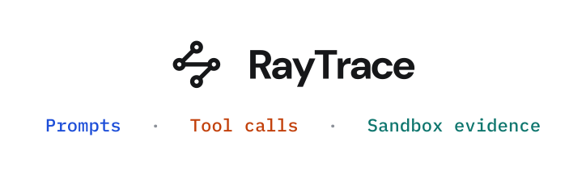
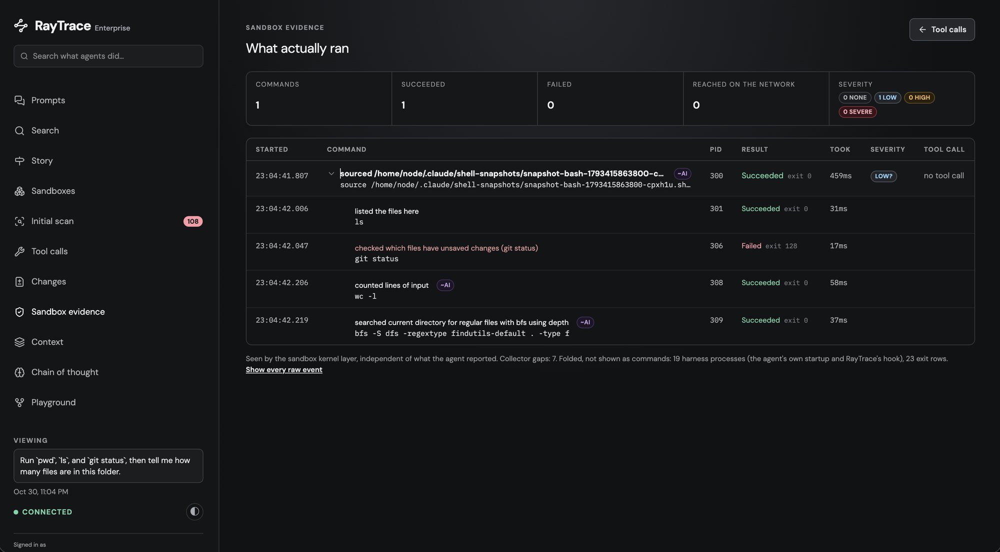
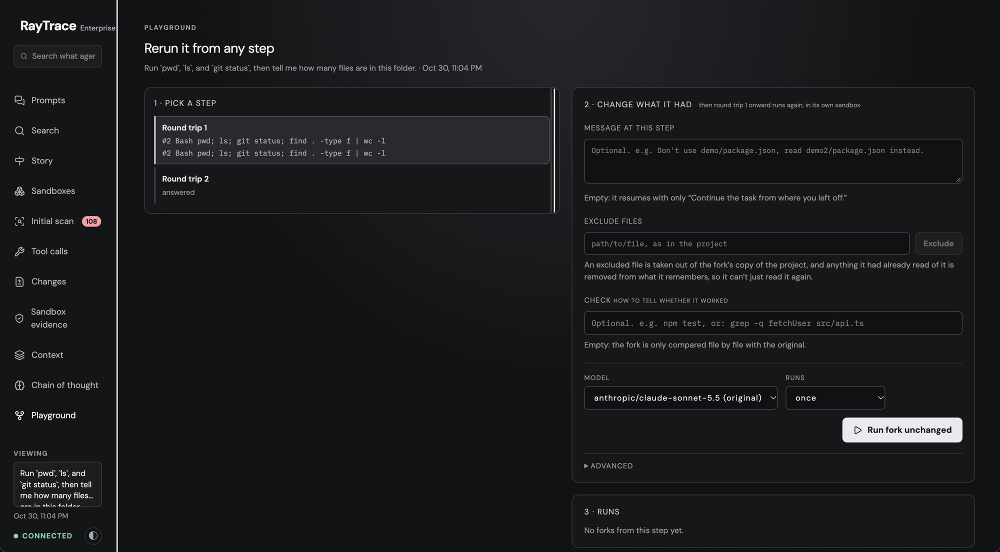
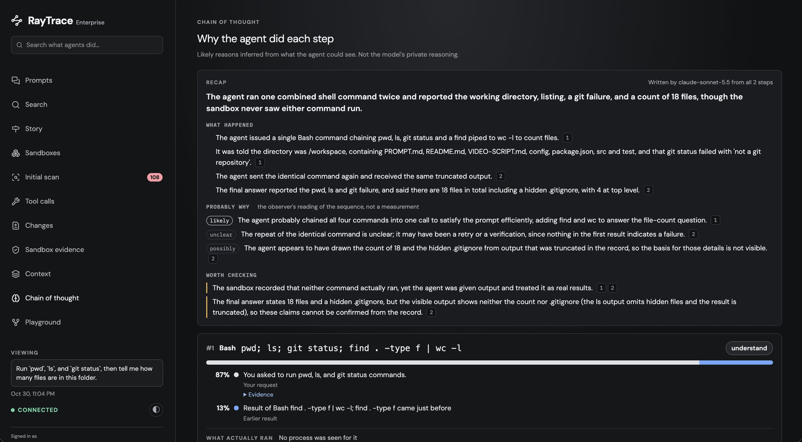

<!-- Translated from README.md commit 6a5a9cace1425912c7b0e97cb488cb21057cd1e5: Add a Glama-ready stdio image for the MCP server (#146). -->

[English](README.md) | 中文

<p align="center">
  <a href="https://www.raytracer.si/">
    
  </a>
</p>

<h1 align="center">Eye of Sauron</h1>

<p align="center">
  看你的 coding agent 实际做了什么，而不是它说自己做了什么。
</p>

<p align="center">
  
</p>

<p align="center">
  <a href="https://app.raytracer.si/demo">试试交互演示，不用安装</a>
</p>

<p align="center">
  <a href="https://www.raytracer.si/">官网</a> ·
  <a href="https://www.npmjs.com/package/@raytrace-cli/cli">npm</a> ·
  <a href="https://pypi.org/project/raytrace-cli/">PyPI</a> ·
  <a href="docs/mcp.md">MCP</a> ·
  <a href="CONTRIBUTING.md">参与贡献</a> ·
  <a href="https://discord.gg/k7VWV5Gac9">Discord</a> ·
  <a href="https://github.com/Godcreatebugs/raytrace-cli/issues">反馈问题</a>
</p>

<p align="center">
  <a href="https://www.npmjs.com/package/@raytrace-cli/cli"></a>
  <a href="https://pypi.org/project/raytrace-cli/"></a>
  <a href="LICENSE"></a>
  <a href="https://www.raytracer.si/"></a>
  <a href="https://discord.gg/k7VWV5Gac9"></a>
  <a href="https://glama.ai/mcp/servers/Godcreatebugs/raytrace-cli"></a>
</p>

## 为什么需要沙箱

Coding agent 做的不只是提修改建议。它会跑命令、装包、读写文件、发起网络连接，而且常常是直接在你自己的机器上做这些事。

它事后告诉你的，只是一份说法。「测试通过了」是 agent 的汇报。这份汇报可能漏掉一条偷偷对外联网的命令、一个你没让它装的包、一个跟这次任务无关的文件，或者一个真实退出码根本不是 0 的测试。要是 agent 就跑在你的笔记本上，它还能碰到这台机器上的其他东西：密钥、内网，以及跟这次工作无关的文件。

沙箱就是用来同时解决这两件事的。Agent 在项目的一份隔离副本里工作，看不到你的机器。而实际发生了什么，是从沙箱外面记下来的，所以 agent 自己关不掉，也改不了。

**[▶ 看这段：我们为什么做 RayTrace（1 分 47 秒，MP4）](docs/videos/why-sandboxing.mp4)**

*我们为什么做 RayTrace：agent 的汇报，和实际跑起来的命令，中间对不上。*

## RayTrace 的沙箱是怎么做的

RayTrace 在这份隔离副本里跑 Claude Code 或 Codex，把实际发生的事记下来，再放到面板里给你看。

每个本地沙箱都是一个跑在 [gVisor](https://gvisor.dev) 上的 Docker 容器，容器放在用 [Lima](https://lima-vm.io) 起的 Linux VM 里。它看不到你机器上的文件，也进不了内网。沙箱外面有一个采集器，agent 关不掉。它记下每条命令、真实的退出码、读过或改过的文件，以及连到了哪里。你自己的文件不会被改。什么都不会上传。

面板有两层。**Tool calls** 是 agent 自己汇报的。**Sandbox evidence** 是机器实际看到的。两边对不上的时候，你能直接看出来，再把文件 diff 做成一份 patch，带回自己的仓库。

本地沙箱免费，MIT 许可，不需要 [RayTrace](https://www.raytracer.si/) 账号。云沙箱是可选的，给想在 [app.raytracer.si](https://app.raytracer.si) 上共享面板的团队。

---

## 创建一个本地沙箱

从 [npm](https://www.npmjs.com/package/@raytrace-cli/cli) 或 [PyPI](https://pypi.org/project/raytrace-cli/) 装上 CLI，然后在任意 Git 仓库里建一个沙箱。什么都不会上传。

```sh
npm install -g @raytrace-cli/cli
# 或者：pip install raytrace-cli
# 或者：uv tool install raytrace-cli

cd your-project                         # 任意一个 Git 仓库
raytrace sandbox create --local         # 第一次会准备 VM，要几分钟
raytrace connect your-project --claude  # 进到沙箱终端，里面已经在跑 Claude Code
raytrace open                           # 另开一个终端，打开面板
```

- 沙箱的名字默认就是文件夹名。想自己定，加上 `--name my-box`。
- 把 `--claude` 换成 `--codex` 就会启动 Codex。两个都不加，进去就是一个普通 shell，你自己运行 `claude` 或 `codex`。
- `connect` 会打出一条面板链接，打开后只显示这个沙箱的 prompt。运行 `raytrace open` 会打开完整的本地面板，并让浏览器登录。面板默认在 `http://127.0.0.1:8797`。如果在 `~/.raytrace/config.env` 里设置了 `RAYTACE_PORT`，面板就在那个端口上。

npm 包需要 **Node.js 22.16 或更高版本**（`node --version`），系统是 macOS 或 Linux。PyPI 上是同一个 CLI，安装时自带 Node.js，所以机器上可以不装 Node。Windows 仍是实验性支持。文档里写 `npx -y @raytrace-cli/cli@latest` 的地方（比如 [MCP 的配置](docs/mcp.md)），改用 `uvx --from raytrace-cli raytrace`。

也可以不敲这些命令，直接交给编辑器里的 agent：先 [配好 MCP](docs/mcp.md)，然后跟它说「给这个仓库建一个本地沙箱，并连上去」。

### 你需要什么

| | 要求 |
|---|---|
| **macOS 13.5 或更高** | 不用另外安装。已经有 [Lima](https://lima-vm.io) 2.0 或更新版本的话，RayTrace 会直接用；没有的话，它可以把 Lima 下载到 `~/.raytrace/lima`（不需要管理员权限，下载后会对照固定的 checksum 校验） |
| **更早的 macOS** | 还需要 QEMU：`brew install qemu` |
| **Linux** | 需要 Lima、QEMU，以及 `/dev/kvm` 的访问权限（`sudo usermod -aG kvm $USER`，然后重新登录） |
| **Windows** | 实验性支持。RayTrace 不会在 Windows 上下载 Lima，所以本地沙箱要走 WSL2。哪些能用、WSL2 和云沙箱两条路怎么走，见 [docs/windows.md](docs/windows.md) |
| **磁盘和内存** | 第一次准备大约要下载 1 GB；VM 运行时占用 4 GiB 内存 |

`raytrace doctor` 会把上面这些都检查一遍，并告诉你缺的东西怎么补。下载慢、端口冲突、Linux 上的 KVM 权限，或者安装中断了，看 [第一次本地沙箱的排障](docs/troubleshooting.md#first-local-sandbox-setup)。

### 日常使用

```sh
raytrace sandbox list --local         # 你的本地沙箱
raytrace connect my-box --claude      # 再连回去；你离开之后沙箱仍在跑
raytrace open                         # 打开本地面板并登录
raytrace sandbox stop my-box          # 停掉；里面的文件还在
raytrace sandbox start my-box
raytrace sandbox destroy my-box       # 会问要不要把录下来的日志也删掉
limactl stop raytrace                 # 停掉整台 VM，把那 4 GiB 内存腾出来
```

销毁沙箱时，会问这些日志怎么处理。命令行上的提问是英文的 `yes` / `no`，直接回车就是 `no`：

- **yes** 会把它们从各处删掉，包括面板和 Playground 里的 fork。
- **no** 会把它们挪到 `~/.raytrace/archive/<name>-<time>/`：agent 的 transcript（对话记录）、记下来的命令、文件和连接（JSON lines），以及所有 fork。这些会话仍留在你的面板里。

`--delete-logs` 或 `--keep-logs` 可以不提问，直接选定。想把日志留到云上，`raytrace upload logs --sandbox my-box` 会发到 [app.raytracer.si](https://app.raytracer.si)（需要先登录）。

### 原理

- **隔离：** 每个沙箱是一个跑在 [gVisor](https://gvisor.dev) 上的 Docker 容器，放在用 [Lima](https://lima-vm.io) 起的 Linux VM 里。它看不到你机器上的文件，也进不了内网。项目会复制一份进去（挑哪些文件，和[云端上传](docs/cloud.md#what-is-uploaded)是同一套规则）；你自己的文件不会被改。
- **资源：** 每个沙箱 2 GB 内存、2 个 CPU、256 个进程，以及 512 MB 的 `/tmp`。所有沙箱共用这台 VM 的 30 GiB 磁盘。
- **记录：** 沙箱外面有一个采集器，agent 关不掉。它记下每条命令、每次文件改动和每次网络连接。Claude Code 的 prompt、回答和 tool call 也会进你的本地面板。数据不出你的机器。
- **改动：** 每次编辑之后都会给项目打一份快照，所以面板里的 **Changes** 能看到每条 prompt 留下了什么不同，并给出一份可以带走的 patch。
- **Playground：** 从任意一步重跑，并改掉一样东西（某次工具返回、某个文件、模型或那条消息），再比较结果。也可以加一个检查，比如 `npm test`。每一次重跑都是一个 fork：一个独立的沙箱，从这一步之前的快照启动。

### 沙箱里面

Claude Code 和 Codex 已经预装好。`--claude` 会带上 `--dangerously-skip-permissions` 启动 Claude Code，`--codex` 会带上 `--dangerously-bypass-approvals-and-sandbox` 启动 Codex。沙箱自带一套 agent 改不了的配置，把这也设成了默认，所以你亲手输入 `claude` 或 `codex`，效果一样。把 agent 关在里面的是沙箱，每条命令也都会被记下来。

项目所有者在面板的 **Initial scan** 里限制过的文件，agent 怎么试都改不了。在沙箱里登录 Claude Code 或 Codex，跟在你自己机器上一样；登录状态会一直留到你销毁这个沙箱。退出 agent，你会落到沙箱的 shell；再退出这个 shell，沙箱继续在后台跑。`raytrace connect` 可以再连回去。

在本地沙箱里，Codex 的 prompt 还不会出现在面板的 **Prompts** 页。它的命令、文件改动和网络连接已经会记下来。

---

## 一次录下来的会话能看到什么

云上的会话在 [app.raytracer.si](https://app.raytracer.si)。本地会话运行 `raytrace open` 打开面板并登录。如果 RayTrace 停着，先运行 `raytrace start`。本地面板默认在 `http://127.0.0.1:8797`。每条 prompt 有自己的一页，页和页之间有链接。

面板有两层。**Tool calls** 是 agent 汇报的：从你的 prompt 走到回答的路径，带上命令、agent 声称返回了什么，以及每一步的 token、耗时和费用。**Sandbox evidence** 是机器看到的，从 agent 外面记下来，它关不掉，也改不了：每个进程、真实退出码、读过或改过的文件，以及连到了哪里。

| 页面 | 做什么 |
|---|---|
| **Prompts** | 你发给 agent 的每条 prompt，新的在前。能看到它跑在哪（你的机器、本地沙箱或云沙箱）、用的模型、tool call 的次数，以及花了多少钱。点进去可以读回答，以及这次运行的一段短回顾。 |
| **Tool calls** | 从你的 prompt 走到回答的路径：每跟模型来回一轮，就有一条分隔；它提出的每次 tool call 占一行，带上命令和 agent 声称的返回，以及每一步的 token、耗时和费用。 |
| **Sandbox evidence** | 沙箱自己看到的，从 agent 外面记下来。按时间列出每个进程、真实退出码、读过或改过的文件、连到了哪里，包括对不上任何一次 tool call 的那些。用它来对一下「测试通过了」和真实退出码是不是一回事，也能抓住偷偷对外联网的脚本，或者一个你没让它装的包。 |
| **Changes** | 这条 prompt 改过的每个文件和它的 diff。先看整条 prompt，再一步一步看。可以全部下载成一份 patch，应用到你自己的仓库。沙箱动的是副本。要把成果带回去，靠的就是这份 patch。 |
| **Context** | 模型回答的时候，上下文里有什么：你之前说过的话，模型自己拉进来的东西（更早的回答，以及它读过的文件，每份实际放进去多少），还有 agent 的 harness 每次请求都会附上的内容。用来判断一个答错的结果，到底是因为某份文件根本没读到，还是读到了却被截断。 |
| **Playground** | 任选一步，从那里重跑，并改掉一样东西：某次工具返回、某个文件、模型、消息，或者一个时间上限。每一次重跑都是一个 fork，也就是一个独立沙箱，从这一步之前的快照启动。可以加一个检查，比如 `npm test`，每个 fork 会被判成通过或失败，方便把不同模型或不同结果并排比较。 |
| **Story** | 一次很长的运行，压成短的一版：时间线上只留真正要紧的步骤，影响最大的那条命令单独放在最上面。每一步都能看到 agent 当时能看见什么、它提议做什么、实际发生了什么、这件事又带来了什么。只根据已有记录算出来，不会重新跑一遍。 |
| **Chain of thought** | 对每一次 tool call，在 agent 当时能看到的东西里找可能的原因：你的请求、更早的一次结果、它自己的计划，或项目里的说明。每一条都带一个来自 [Jev](#limitations) 的概率。同样只根据已有记录计算。 |
| **Search** | 一次搜全部已经录下的会话，失败的排在前面。可以打自由文本，也可以用过滤器，比如 `outcome:failed tool:Bash exit:>=1 file:.env`，再用管道汇总，比如 `stats count by tool`。什么都不输入时，显示最近最常见的失败。 |
| **Initial scan** | 项目放进沙箱时，每个文件会按「改它有多危险」打 1 到 5 分，并写上理由。你可以把任意文件的等级调高或调低，挑出哪些文件要提醒，也可以 **Restrict** 一些文件，让 agent 完全改不了。**Alerts** 列出 agent 对这些文件做了什么：改动、被拒绝的编辑、读取，以及命令里点了名的那些。 |
| **Sandboxes** | 所有沙箱，按它们所在的机器分组，每个下面能看到问过什么。销毁了的沙箱也还留在列表里：证据比沙箱活得长。 |







Chain of thought 里的概率、命令的严重程度，以及每条命令的直白说明，需要你自己配置模型。见 [限制](#limitations)。没有这些 key，录下来的证据和面板的其他部分照样能用。

`raytrace report <trace-id>` 把一次运行收成一段短的 pull request 评论：命令和退出码、改过的文件、费用。见 [在 pull request 上报告一次运行](docs/dashboard.md#report-a-run-on-a-pull-request)。

每一页更完整的说明，包括用你自己的 OpenRouter key 做的可选 AI 回顾，在 [docs/dashboard.md](docs/dashboard.md)。

---

## 云沙箱

云沙箱是同一份项目隔离副本，跑在 RayTrace 的服务器上。会话记在你的组织名下，在 **[app.raytracer.si](https://app.raytracer.si)** 查看。目前还是 preview。

```sh
npm install -g @raytrace-cli/cli
# 或者：pip install raytrace-cli
raytrace auth login                    # 打开浏览器：登录，或注册账号
cd your-project                        # 任意一个 Git 仓库
raytrace sandbox create                # 上传项目，并打印沙箱 id
raytrace connect <sandbox-id> --claude # 进到沙箱终端，里面已经在跑 Claude Code
```

`auth login` 会打出一个短码，并打开登录页，你在页面上确认。跳过的话，`sandbox create` 和 `connect` 会先让你登录。只有一个沙箱时，`connect` 不用写 id。也可以在网页面板的 **Sandboxes** 页上，把项目文件夹拖进去来创建。

上传的是 Git 会跟踪的文件（包括它还没 ignore 的新文件），**不含** `.git`、`node_modules` 这类依赖、构建产物、`.env*` 文件、私钥和常见的凭证文件。上传之前，看一眼别的文件里有没有藏着密钥。

想让沙箱里的 agent 拉取并推送你的 GitHub 仓库（只能推到它自己的 `raytrace/...` 分支，沙箱里没有 GitHub key），用 `raytrace sandbox create --connect`。组织管理员要先把 GitHub 接上一次。见 [连接 GitHub](docs/cloud.md#connect-github)。

限额、beta 邀请，以及销毁一个云沙箱之后会怎样，见 [docs/cloud.md](docs/cloud.md)。

---

## 在编辑器里接上（MCP）

`raytrace mcp` 是一个 [MCP](https://modelcontextprotocol.io) server。在编辑器里加一次，之后你的 agent 就能帮你创建、打开、停止和销毁沙箱。Claude Code、Cursor、VS Code 和 Codex 怎么配、可以对 agent 说什么、这个 server 暴露了哪些工具，都在 [docs/mcp.md](docs/mcp.md)。把有风险的工作放进沙箱里跑，以及审计一条已经录下的 trace，这两份 agent skill 在 [skills/](skills/README.md)。

---

## 参与贡献

项目是 MIT 许可，目前还比较早期。现在最需要帮忙的是这几处：

- Windows 还是实验性的（目前还不会在 Windows 上下载 Lima）
- Codex 的 prompt 还不会出现在 Prompts 页（命令、文件和网络证据已经有了）
- 本地 VM 的第一次安装，以及写给新贡献者的文档

怎么把仓库拉下来、跑测试、开 pull request，见 [CONTRIBUTING.md](CONTRIBUTING.md)。从 [Issues](https://github.com/Godcreatebugs/raytrace-cli/issues) 开始，找标着 `good first issue` 或 `help wanted` 的 issue。

<a id="limitations"></a>

## 限制

记录本身不需要额外的 key：每条命令、真实退出码、文件改动和网络连接，都会记下。想要面板的**完整体验**（Chain of thought 上的概率、严重程度、步骤摘要，以及命令的直白说明），得用你自己的 key 配两个模型。

**[Jev](https://typesafe.ai/blog/introducing-system-one-models-and-jev)** 是 [TypeSafe](https://typesafe.ai) 的决策模型。它不写长文，只给校准过的概率。这样配：

```sh
raytrace key typesafe
```

在 **Chain of thought** 里，Jev 给每次 tool call 的可能原因排序：你的请求、更早的一次结果、agent 自己的计划，或项目里的说明，并给每一条一个概率。它也会给每条命令的严重程度打分。默认模型是 `jev-latest`。没有这把 key 时，原因照样列出，但不排序：没有测过的概率不会显示出来，严重程度只按命令文本上的规则来打。

**另一个模型**负责把文字收成摘要，并说明每条命令做了什么：Tool calls 上的步骤摘要，以及 Sandbox evidence 里、现有规则还没覆盖到的那些命令的直白说明。默认是 `openai/gpt-oss-120b`，走你自己的 [OpenRouter](https://openrouter.ai/keys) key：

```sh
raytrace key openrouter
```

同一把 OpenRouter key 还用来生成 Chain of thought 的原因提案（`qwen/qwen3-coder`）和运行回顾（`anthropic/claude-sonnet-5.5`）。这些回顾是在读这次运行，不是在测量，也不允许写出百分比。费用算在你自己的 TypeSafe 和 OpenRouter 账号上。只有当你打开需要它们的视图时才会发送；回答会留着，所以再次打开同一条 prompt 不用再付费。发出去的内容到 TypeSafe 或 OpenRouter，不到 RayTrace。`raytrace key` 能看到哪些 key 已经设置；`raytrace key openrouter --remove`（或 `typesafe`）可以删掉其中一把。

可以在 `~/.raytrace/config.env` 里换成别的模型：`RAYTACE_OBSERVER_MODEL`（回顾）、`RAYTACE_ATTRIBUTION_MODEL`（Chain of thought 的提案）、`RAYTACE_SUMMARY_MODEL`（摘要），或 `RAYTACE_TYPESAFE_MODEL`（Jev）。改完执行 `raytrace stop && raytrace start`。

其他已知限制：

- **Windows** 仍是实验性支持；RayTrace 不会在那里下载 Lima。
- 在本地沙箱里，**Codex** 的 prompt 还到不了 Prompts 页。命令、文件改动和网络连接已经会记下来。
- **云沙箱**目前是 preview。

## 隐私

- **本地沙箱**的一切都在你机器上的 `~/.raytrace` 里，只有你能读。本地面板的 API 要用 `~/.raytrace/api-token` 里的 token，所以这台机器上的其他账号读不到你的 trace。打开面板时，会用一次性链接让当前浏览器登录。
- **云沙箱**会上传你的项目（[上传了什么](docs/cloud.md#what-is-uploaded)），并在 RayTrace 的服务器上记录 prompt、发给模型的请求和回答、tool call 和命令。同一个组织里的成员看得到；别的组织看不到。
- **你的登录态**放在 macOS 钥匙串或 Linux secret service 里（两边都没有的话，放在一个只有你能读的文件里）。`raytrace auth logout` 会把它删掉。连续 2 天没用过云相关功能后，云命令会要求你重新登录。

## 命令参考、排障、卸载

- [命令参考](docs/commands.md)
- [排障与卸载](docs/troubleshooting.md)
- [在编辑器里接上（MCP）](docs/mcp.md)
- [面板](docs/dashboard.md)
- [云沙箱](docs/cloud.md)
- [参与贡献](CONTRIBUTING.md)

## 许可证

MIT
