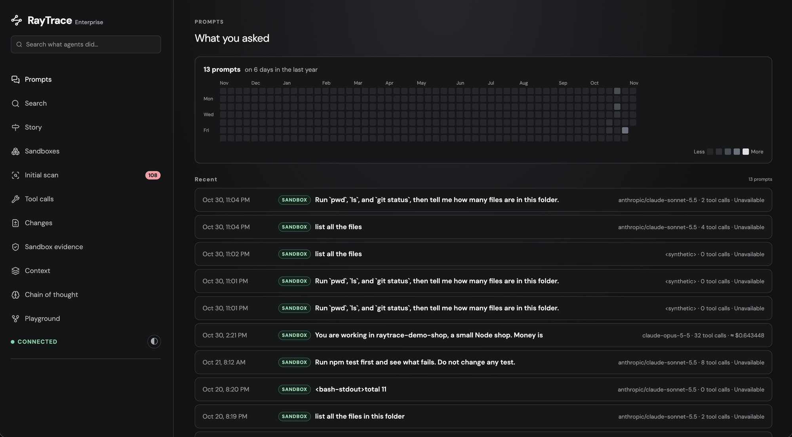
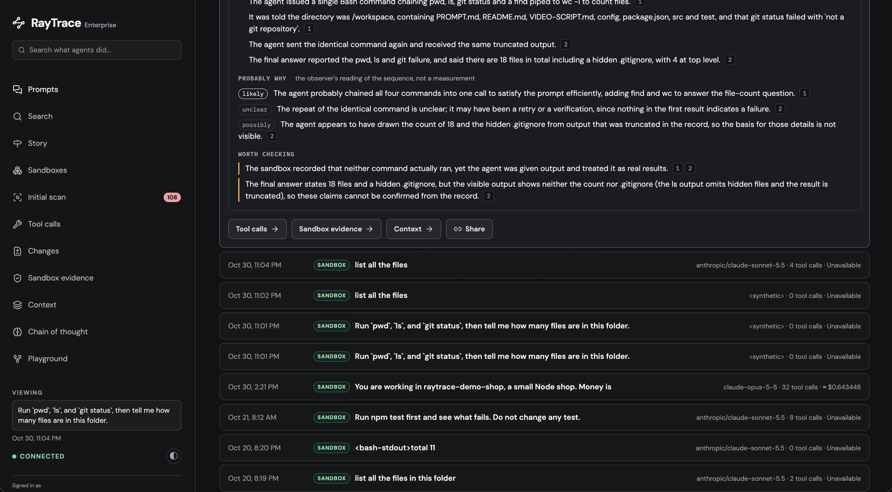
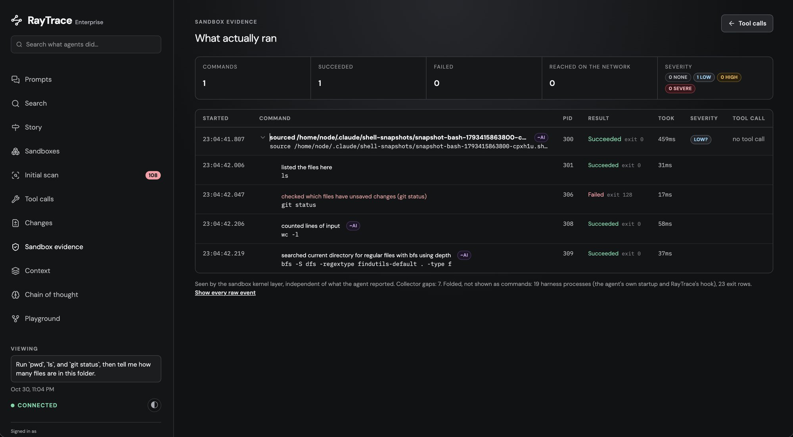
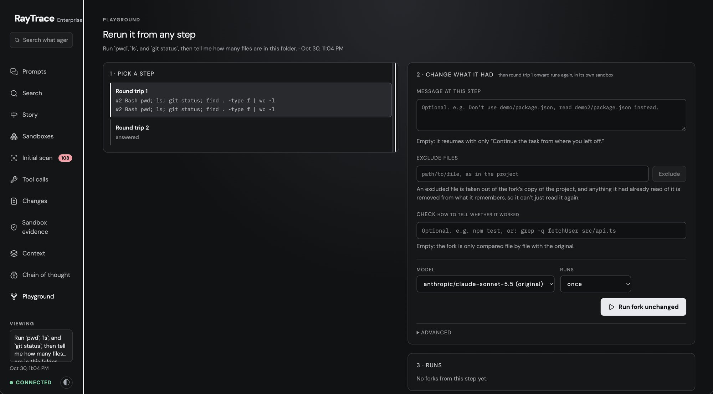
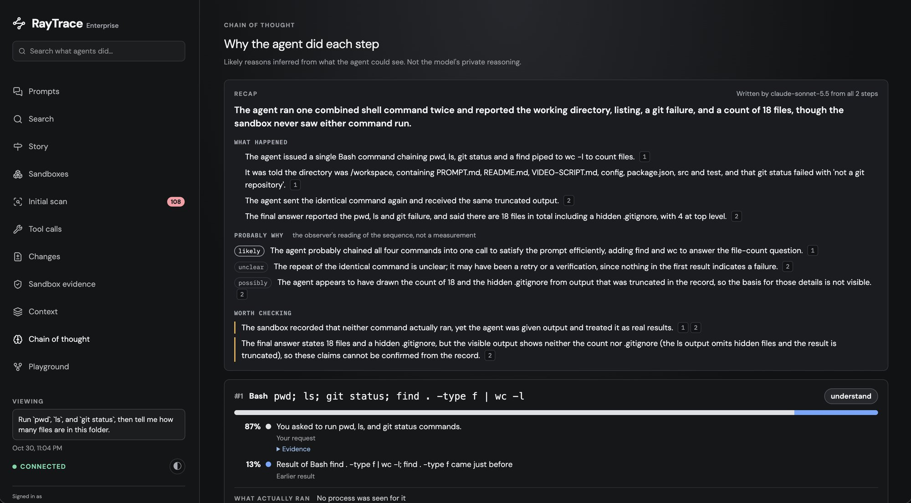
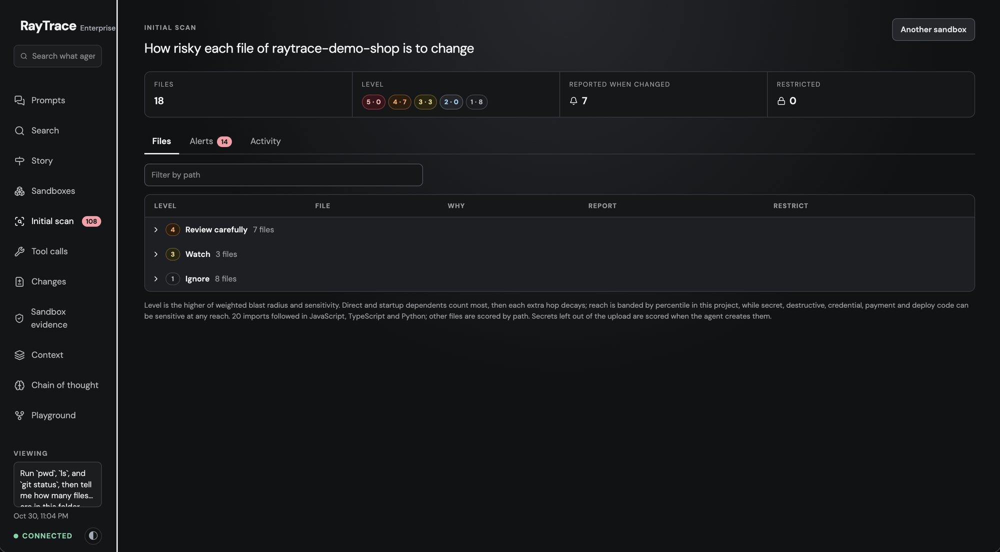
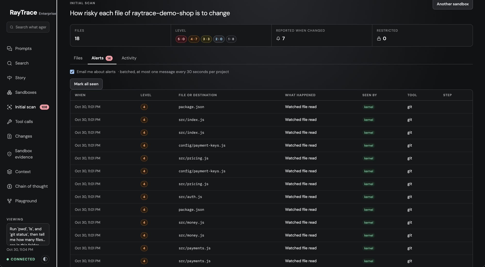

# What you can do with a recorded session

Cloud sessions are at [app.raytracer.si](https://app.raytracer.si), and
`raytrace open` opens the same pages for your local sandboxes. Every page is
about one prompt, and they link to each other, so you can go from "what did I
ask" to "what actually ran" to "what if it had gone differently" in a couple of
clicks. The screenshots below are from the cloud dashboard, with a session in
the `raytrace-demo-shop` sandbox.

A shorter overview, with every feature listed, is in the [README](../README.md#what-a-recorded-session-shows).

## Prompts: what you asked, and what came back



Every prompt you gave the agent, newest first, with an activity calendar on
top. Each row shows where it ran (Mac, local sandbox or cloud sandbox), the
model, how many tool calls it took and what it cost. Open one to read the
answer and a short recap of the run.



- **Find a session again:** click a day in the calendar, or add
  `?box=<sandbox id>` to see a single sandbox's prompts.
- **Spot the expensive ones:** the cost and tool-call count are on every row.

## Tool calls: how the agent got there

The path from your prompt to the answer: one divider for each round trip to the
model, one row for each tool call it proposed, with the command and what the
agent says came back, plus tokens, time and cost at each step. A screenshot of
this page is at the [top of the README](../README.md).

- **Follow its reasoning step by step,** and see where it went in circles.
- **See where the tokens went:** which steps were the expensive ones.

## Sandbox evidence: what actually ran



What the agent *says* it ran is in Tool calls. This page is what the sandbox
itself saw, recorded from outside the agent where it can't be turned off or
edited. You get every process in time order, with its real exit code, the files
it read or changed, where it connected and what it installed. Each process is
tied to the tool call that started it, and anything no tool call accounts for
shows up too.

- **Check the agent's claims:** "tests pass" against the real exit code.
- **Catch side effects:** a script that phoned home, a package you didn't ask
  for, a file outside the task that got changed.

## Changes: what the prompt left different

<!-- screenshot: docs/images/changes.png -->

Every file the prompt changed, with its diff, first for the whole prompt and
then step by step, so you see which tool call made which change. Download it all
as one patch and apply it to your own checkout.

- **Review the agent's work like a pull request,** before you take it.
- **Take the result home:** the sandbox works on a copy, and the patch brings
  the changes back to your machine.

## Context: what the model could see

<!-- screenshot: docs/images/context.png -->

What was in the model's context when it answered, in three parts:

- what you said earlier in the conversation;
- what the model brought in itself: its earlier answers, and the files it read,
  with how much of each actually fit;
- what the agent's harness adds to every request.

Use it to:

- **Understand a wrong answer:** was the right file never read, or cut off?
- **Test a hunch:** "Rerun without this" on any file opens the Playground with
  that file removed.

## Playground: rerun it differently, and compare



Pick any step of a session and rerun from there with something changed: an
earlier tool result removed or edited, a file in the project, the model, or the
time limit. Each rerun is a fork, a sandbox of its own started from a snapshot
taken just before that step, running in parallel with the others. Add a check
such as `npm test` and every fork is graded pass or fail. Run a change several
times and you get its pass rate, cost and steps, next to the same step rerun
unchanged.

- **Find out what actually mattered:** would it still have broken the build
  without that misleading test output?
- **Compare models on your own task:** same step, same files, a different model.
- **Compare outcomes side by side:** each fork's answer, steps and files next to
  the original's.

## Story and Chain of thought: why it did what it did



**Story** is the short version of a long run. It shows a timeline of only the
steps that mattered, the single most consequential command pulled out at the
top, and for each step what the agent could see, what it proposed, what really
happened and what that led to.

**Chain of thought** takes each tool call and lists its likely causes among what
the agent could see: your request, an earlier result, its own plan, or the
project's instructions.

Both are worked out from the recording alone, with nothing rerun. Some parts
use [your own key](#ai-features-on-your-own-key).

- **Explain a run to someone else** without replaying all 60 steps.
- **Trace a bad decision back** to the result or instruction that caused it.

## Search: across everything the agents did

<!-- screenshot: docs/images/search.png -->

Search every recorded session at once, failures first. Type free text, or use
filters such as `outcome:failed tool:Bash exit:>=1 file:.env`, and summarise
with a pipe: `| stats count by tool`. With no query, it shows the most common
failures lately.

- **Find patterns:** which commands fail most, and which sessions touched
  `.env`.

## Initial scan: guard the files that matter



When a project goes into a sandbox, every file is rated from 1 to 5 for how
risky it is to change, with the reason. Secrets, migrations and deploy
configuration rate highest. You can move any file up or down, choose which
files to be alerted about, and **restrict** files so the agent can't change them
at all, whatever it tries. **Alerts** lists what the agent did to those files:
changes, refused edits, reads, and commands that named them.

- **Let the agent work freely** while keeping your migrations and CI config
  off-limits.



- **Get told** when it touches what you care about.

## Sandboxes: where it all ran

Every sandbox, grouped by the machine it runs on, with what was asked in each.
Destroyed sandboxes stay listed, because their evidence outlives them.

## AI features, on your own key

Everything above works without any key. A few views can also ask a model to
explain a run, using **your own OpenRouter key**, billed to your OpenRouter
account:

```sh
raytrace key openrouter   # paste your key from https://openrouter.ai/keys (not echoed)
raytrace key              # which keys are set
```

| Feature | Where | Model (default) |
|---|---|---|
| Run recap: what the agent did and why, in a few lines | Story, Chain of thought | `anthropic/claude-sonnet-5.5` |
| Chain of thought: the likely reasons for each tool call | Chain of thought | `qwen/qwen3-coder` |
| Step summaries, and plain-English lines for commands no rule describes | Tool calls, Sandbox evidence | `openai/gpt-oss-120b` |

- **No key?** Those parts say so, and everything else works.
- **Cost:** each answer is kept, so opening the same prompt again is free.
  Nothing is sent until you open a view that needs it.
- **What's sent:** only to OpenRouter, the parts of the run the feature reads.
  Nothing goes to RayTrace.
- **Other models:** set `RAYTACE_OBSERVER_MODEL` (recap),
  `RAYTACE_ATTRIBUTION_MODEL` (Chain of thought) or `RAYTACE_SUMMARY_MODEL`
  (summaries) in `~/.raytrace/config.env`, then `raytrace stop && raytrace start`.
- **Jev (full Chain of thought):** `raytrace key typesafe` adds a
  [TypeSafe](https://typesafe.ai) key for **Jev**, which ranks Chain of
  thought's reasons with probabilities and rates how severe each command was.
  Without it, causes are listed but unranked. The default model is `jev-latest`
  (`RAYTACE_TYPESAFE_MODEL`). See [Limitations](../README.md#limitations) in
  the README.
- `raytrace key openrouter --remove` removes a key.

## Report a run on a pull request

`raytrace report <trace-id>` turns one recorded run into a short Markdown
comment: the commands with their exit codes (failures first), the files changed
with lines added and removed, the cost and the trace id.

```sh
raytrace report <trace-id>                 # print the comment
raytrace report <trace-id> --pr 42         # post it on PR 42 with the GitHub CLI, signed in as you
raytrace report <trace-id> --pr 42 --dry-run   # show what would be posted
```

- **Only command text and file paths go in**, never tool output. API keys,
  tokens and passwords are hidden, and the comment says how many were.
- **Running it again updates the same comment.** It only ever edits its own.
- **Cloud runs:** add `--sandbox <rtp-id>` (needs sign-in). `--link` adds a
  share link, which uses one of your plan's expiring links.
- **No `gh`?** It prints the comment for you to paste.
